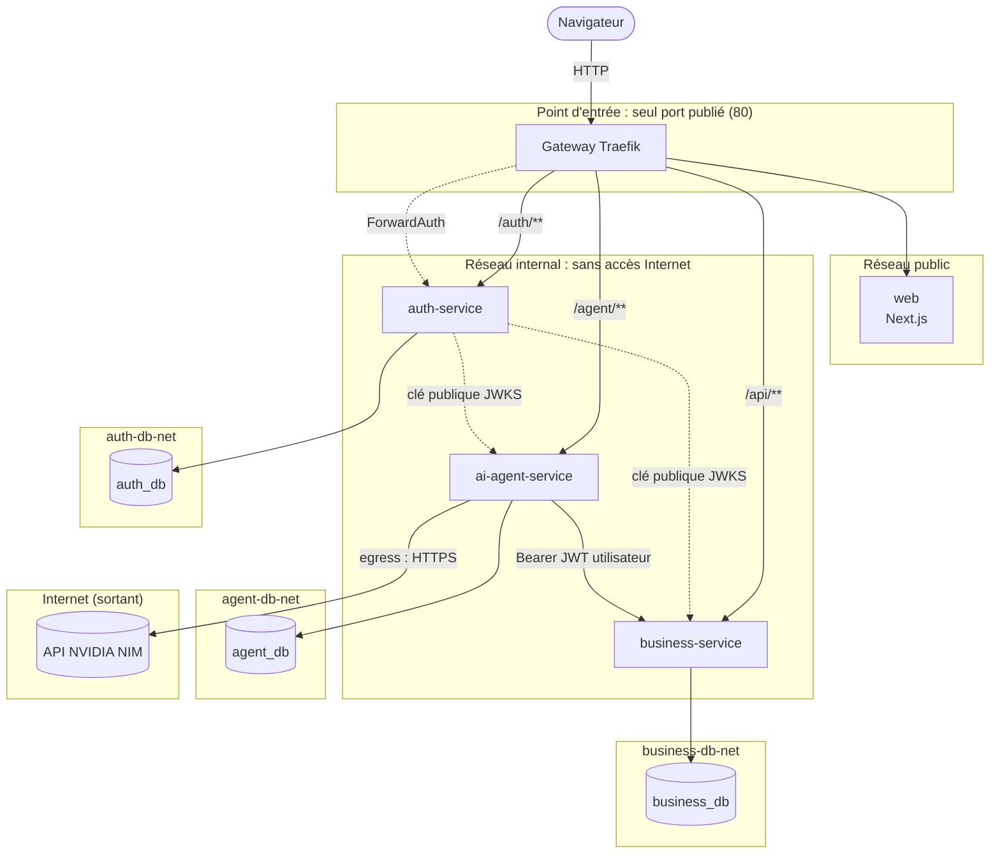

# Architecture distribuée

Plateforme découpée en trois microservices (Auth, Métier, Agent IA) et un front, derrière une API Gateway unique.

## Vue d'ensemble

Lecture :

- **Cadres** : réseaux Docker. Un élément ne peut joindre que ce qui partage un réseau avec lui. Chaque base est seule dans son réseau avec son service.
- **Traits pleins** : requêtes applicatives. **Pointillés** : contrôle d'accès (ForwardAuth : vérification du jeton par la gateway ; JWKS : clé publique distribuée par auth-service pour que les services vérifient les jetons sans pouvoir en signer).
- **Simplification du dessin** : un élément n'apparaît que dans un cadre. En réalité, la gateway est sur les réseaux `public` et `internal`, et chaque service est aussi sur le réseau de sa base. Le détail exact est dans le tableau « Isolation réseau » ci-dessous.

## Services

| Service | Responsabilité | Routes gateway | Base |
| --- | --- | --- | --- |
| `gateway` (Traefik v3) | Point d'entrée unique : routage, en-têtes de sécurité, ForwardAuth, CORS, rate limiting | — | — |
| `web` (Next.js) | Interface utilisateur. N'appelle que la gateway (même origine) | `/` | — |
| `auth-service` | Identifiants, émission des JWT RS256 et des refresh tokens, JWKS, vérification pour la gateway | `/auth/**` | `auth_db` |
| `business-service` | Documents, règles d'accès, recherche plein texte, filtrage par rôle et département | `/api/**` | `business_db` |
| `ai-agent-service` | Prompts backend ([Prompt Book](prompt-book.md)) enchaînés recherche → réponse → vérification, appel du LLM (Nemotron 3.5 Super via NVIDIA NIM), historique des échanges | `/agent/**` | `agent_db` |

Les trois services sont des applications Next.js en mode API seul (route handlers, aucune page). Le code commun (contrôle d'accès, format d'erreur, configuration) est dans `packages/shared`, qui ne contient ni données ni connexion à une base.

## Isolation réseau

Seule la gateway publie un port. Chaque base n'est joignable que par son service.

| Réseau | Membres | Sortie Internet | Rôle |
| --- | --- | --- | --- |
| `public` | gateway, web | oui | Gateway ↔ front |
| `internal` | gateway, auth, business, agent | **non** | Gateway ↔ services, appels entre services |
| `egress` | ai-agent-service | oui | Seul accès sortant, vers l'API NVIDIA NIM |
| `auth-db-net` | auth-service, auth_db | non | Base privée d'auth |
| `business-db-net` | business-service, business_db | non | Base privée métier |
| `agent-db-net` | ai-agent-service, agent_db | non | Base privée agent |

Conséquences :

- un service compromis ne peut pas lire la base d'un autre service (pas de route réseau) ;
- seul l'agent IA peut sortir sur Internet : une fuite de données par un autre service n'a pas de canal direct ;
- le front ne peut pas contourner la gateway pour appeler un service.

## Principes

- **Une base par service** : aucun service n'accède à la base d'un autre. Les données transitent par API.
- **Gateway unique** : toute la configuration de routage est dans `infra/traefik/dynamic.yml` (provider fichier). La gateway n'a pas accès au socket Docker.
- **Services sans état** : l'identité voyage dans le JWT, ce qui permet de multiplier les instances d'un service.
- **Communication synchrone** REST/JSON, avec des timeouts sur tous les appels sortants (3 s entre services, 30 s vers le LLM).
- **Défense en profondeur** : la gateway filtre les requêtes non authentifiées, et chaque service revérifie le JWT. Le détail est dans [securite.md](securite.md).

Contrats d'API détaillés : [interconnexion.md](interconnexion.md).

## Choix techniques

| Choix | Raison |
| --- | --- |
| Monorepo pnpm + Turborepo | Un seul dépôt multi-modules, build incrémental, code partagé typé |
| TypeScript strict, Next.js pour tous les modules | Une seule stack pour l'équipe, route handlers suffisants pour des API |
| Traefik | Gateway déclarative, ForwardAuth, rate limiting et en-têtes intégrés |
| PostgreSQL (une instance par service) | Isolation des données réelle, pas seulement logique |
| JWT RS256 (`jose`) | Vérification par clé publique : seul auth-service peut signer |
| zod | Validation de toutes les entrées, messages d'erreur en français |
| postgres.js | SQL paramétré, migrations au démarrage, sans ORM ([D16](decisions.md)) |
| NVIDIA NIM (`nvidia/nemotron-3.5-super-vl-120b-a12b`) | Brique d'IA générative externe, API au format OpenAI, appelée uniquement depuis le backend ([D20](decisions.md)) |
