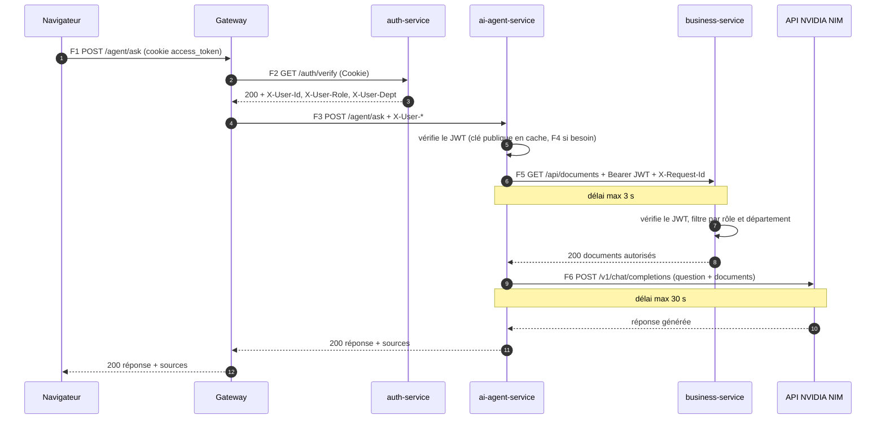

# Spécifications d'interconnexion

Comment les composants de la plateforme communiquent entre eux : protocole, qui a le droit d'appeler qui, contenu de chaque échange et comportement en cas de panne.

Ce document est le contrat entre les services. Les réseaux et le routage qui rendent ces échanges possibles sont configurés depuis la semaine 1 (`docker-compose.yml`, `infra/traefik/dynamic.yml`) ; le code des routes est écrit en semaine 2 et vérifié par les tests de bout en bout (`pnpm test:e2e`, voir [developpement.md](developpement.md)). Voir aussi : contrôle d'accès dans [securite.md](securite.md), routage de la gateway dans [gateway.md](gateway.md), prompts dans [prompt-book.md](prompt-book.md).

## 1. Principes

| Sujet | Choix | Raison |
| --- | --- | --- |
| Style | REST, corps JSON (UTF-8), sur HTTP/1.1 | Simple, outillé, lisible dans les journaux |
| Mode | Synchrone : chaque appel attend sa réponse | Chaque échange a besoin du résultat pour continuer (vérifier un jeton, lire des documents avant d'interroger le LLM). Aucun traitement différé à ce stade, donc pas de file de messages ([décision D11](decisions.md)). |
| Adressage | Nom du service Docker et port 3000 : `http://business-service:3000` | Résolu par le DNS interne de Docker : pas d'adresse IP en dur, pas d'annuaire à maintenir |
| Transport | HTTP dans les réseaux Docker internes, HTTPS vers l'API NVIDIA NIM | Le trafic interne ne quitte pas l'hôte ; le seul échange qui sort sur Internet est chiffré |
| Identité | Le JWT de l'utilisateur accompagne chaque appel | Chaque service vérifie lui-même qui est à l'origine de la requête. Aucun service n'a de droits propres. |
| Délais | 3 s entre services, 30 s vers le LLM | Une dépendance lente ne bloque pas toute la chaîne |
| Corrélation | En-tête `X-Request-Id`, recopié d'appel en appel | Suivre une même requête dans les journaux de tous les services |

### En-têtes échangés

| En-tête | Posé par | Rôle |
| --- | --- | --- |
| `Cookie: access_token=<JWT>` | Navigateur | Identité de l'utilisateur (cookie `HttpOnly`) |
| `Authorization: Bearer <JWT>` | ai-agent-service, vers business-service | Même jeton, transmis entre services |
| `X-User-Id`, `X-User-Role`, `X-User-Dept` | Gateway, après ForwardAuth | Informatifs (journaux). Jamais une preuve d'identité : seul le JWT fait foi. |
| `X-Request-Id` | Le premier service qui traite la requête, s'il est absent | Recopié dans tous ses appels sortants et dans ses réponses d'erreur |
| `X-Forwarded-For`, `X-Forwarded-Proto`, `X-Forwarded-Host` | Gateway | IP, protocole et hôte d'origine du client |
| `Content-Type: application/json` | Tout appelant qui envoie un corps | Format du corps |

## 2. Carte des échanges

Numérotation reprise dans la suite du document. Les composants sont ceux du [schéma d'architecture](architecture.md).

| # | Appelant | Appelé | Protocole | Réseau | Identité transmise | Délai max |
| --- | --- | --- | --- | --- | --- | --- |
| F1 | Navigateur | Gateway (port 80) | HTTP | port publié par l'hôte | Cookie `access_token` | — |
| F2 | Gateway | auth-service `GET /auth/verify` | HTTP | `internal` | `Cookie`, `Authorization` | géré par Traefik |
| F3 | Gateway | Service cible (`/auth`, `/api`, `/agent`) ou web (`/`) | HTTP | `internal` (`public` pour web) | Cookie + `X-User-*` | géré par Traefik |
| F4 | business-service, ai-agent-service | auth-service `GET /.well-known/jwks.json` | HTTP | `internal` | Aucune (clé publique) | 3 s |
| F5 | ai-agent-service | business-service `GET /api/documents` | HTTP | `internal` | `Authorization: Bearer` (JWT de l'utilisateur) | 3 s |
| F6 | ai-agent-service | API NVIDIA NIM | HTTPS | `egress` | Clé API NIM | 30 s |
| F7 | Chaque service | Sa propre base | PostgreSQL (5432) | `<service>-db-net` | Identifiants de la base | 3 s (connexion) |
| F8 | Docker | `/health` de chaque conteneur | HTTP | Local au conteneur | Aucune | 3 s |

### Échanges impossibles

Ces interdictions sont garanties par les réseaux Docker, pas seulement par le code :

| Échange | Pourquoi c'est impossible |
| --- | --- |
| Navigateur → un service ou une base | Seule la gateway publie un port |
| web → un service | web n'est que sur `public`, les services sont sur `internal` |
| Un service → la base d'un autre service | Chaque base est seule sur son réseau avec son service |
| auth-service ou business-service → Internet | `internal` n'a pas de sortie ; seul ai-agent-service est aussi sur `egress` |
| Internet → `/auth/verify`, `/.well-known/jwks.json`, `/health` | Aucun routeur dans la gateway |

Les services partagent le réseau `internal` : un appel non prévu (par exemple business-service → ai-agent-service) est donc techniquement routable. Il n'est pas utilisé, et il échouerait de toute façon sans JWT valide, puisque chaque route protégée vérifie le jeton.

## 3. Détail des échanges

### F1 et F3 : navigateur → gateway → service

1. Le navigateur n'appelle que la gateway, sur la même origine que le front (`/auth/...`, `/api/...`, `/agent/...`). Le cookie `access_token` est envoyé automatiquement.
2. La gateway choisit le routeur selon le chemin, applique ses middlewares (`strip-identity`, `security-headers`, puis `jwt-auth` sur les routes protégées, voir F2).
3. Elle transmet la requête au service **sans modifier le chemin** : `/api/documents` arrive à business-service sous la forme `/api/documents`. Les routes des services sont donc écrites avec leur préfixe (`app/api/documents/route.ts`).
4. Elle ajoute `X-User-*` (issus de F2) et `X-Forwarded-*`. La réponse du service revient au navigateur par le même chemin.

### F2 : vérification du jeton par la gateway (ForwardAuth)

Avant de transmettre une requête protégée, Traefik envoie à auth-service :

```http
GET /auth/verify HTTP/1.1
Host: auth-service:3000
Cookie: access_token=<JWT>
X-Forwarded-Method: GET
X-Forwarded-Uri: /api/documents
X-Forwarded-For: <IP du client>
```

Seuls `Cookie` et `Authorization` de la requête d'origine sont recopiés (`authRequestHeaders`) : auth-service ne voit ni le corps ni les autres en-têtes.

| Réponse d'auth-service | Effet |
| --- | --- |
| 200, corps vide, en-têtes `X-User-Id`, `X-User-Role`, `X-User-Dept` | Traefik recopie ces trois en-têtes dans la requête et la transmet au service (F3) |
| 401, format d'erreur commun | Traefik renvoie cette réponse au client. Le service n'est jamais appelé. |
| Pas de réponse (auth-service arrêté) | Traefik répond en erreur et ne transmet rien : la gateway reste fermée |

### F4 : récupération de la clé publique (JWKS)

```http
GET /.well-known/jwks.json HTTP/1.1
Host: auth-service:3000
```

Réponse 200 :

```json
{ "keys": [{ "kty": "RSA", "n": "...", "e": "AQAB", "kid": "...", "alg": "RS256", "use": "sig" }] }
```

- Pas d'authentification : une clé publique n'est pas un secret.
- Le service garde la clé en mémoire. Il ne la redemande que si un jeton porte un `kid` inconnu (rotation de clé), au plus une fois toutes les 30 s.
- Si auth-service est injoignable et qu'aucune clé n'est en cache : réponse 502 `UPSTREAM_ERROR` au client.

### F5 : l'agent IA lit les documents auprès du service métier

```http
GET /api/documents?q=conges&limit=5 HTTP/1.1
Host: business-service:3000
Authorization: Bearer <JWT de l'utilisateur>
X-Request-Id: 7f3c9a2e-...
```

- L'agent lit le jeton dans le cookie de la requête reçue et le transmet tel quel. Il n'en fabrique jamais : seul auth-service sait signer.
- L'appel va directement sur le réseau `internal`, sans passer par la gateway, donc sans ForwardAuth. C'est pourquoi business-service revérifie toujours le jeton lui-même (F4).
- business-service filtre selon le rôle et le département du jeton : l'agent reçoit exactement ce que l'utilisateur obtiendrait en appelant `/api/documents` lui-même.
- Contrat de la route : [section 5](#get-apidocuments).

### F6 : l'agent IA interroge le LLM (NVIDIA NIM)

```http
POST /v1/chat/completions HTTP/1.1
Host: integrate.api.nvidia.com
Authorization: Bearer <NIM_API_KEY>
Content-Type: application/json

{
  "model": "nvidia/nemotron-3.5-lightning-30b-a3b",
  "messages": [
    { "role": "system", "content": "<règles du prompt agent.ask>" },
    { "role": "user", "content": "<documents>...</documents>\n\n<question>...</question>" }
  ],
  "temperature": 0.1,
  "max_tokens": 600,
  "stream": false,
  "chat_template_kwargs": { "enable_thinking": false }
}
```

Format OpenAI : réponse `{ "model", "choices": [{ "message": { "content" } }], "usage" }`. Aucun mode JSON n'est imposé : le format de sortie est demandé par le prompt ([prompt-book.md](prompt-book.md), section 2).

- C'est le seul échange qui sort de la plateforme, et ai-agent-service est le seul service connecté au réseau `egress`.
- Ne part vers NVIDIA que la question et les documents reçus en F5 : jamais de jeton, d'identifiant ni de donnée d'un autre utilisateur.
- La clé API n'existe que dans les variables d'environnement d'ai-agent-service (`NIM_API_KEY`).
- Si aucun document autorisé ne correspond à la question, le LLM n'est pas appelé : l'agent répond « Je ne trouve pas cette information… ».
- Texte exact des prompts, paramètres et traitement de la réponse : [prompt-book.md](prompt-book.md).

### F7 : chaque service et sa base

- Protocole PostgreSQL sur le port 5432, adresse fournie par `DATABASE_URL` (`postgresql://<user>:<mot de passe>@<service>-db:5432/<base>`).
- Une base, un utilisateur PostgreSQL et un réseau par service : aucun service ne connaît les identifiants d'une autre base.
- Les données d'un autre service s'obtiennent uniquement par son API (exemple : F5).

### F8 : healthcheck

- Docker exécute `GET http://127.0.0.1:3000/health` dans chaque conteneur toutes les 15 s (délai 3 s, conteneur marqué défaillant après 3 échecs).
- Réponse : `{ "status": "ok", "service": "business-service", "time": "2026-10-01T09:00:00.000Z" }`.
- `/health` n'est pas routé par la gateway : il n'est pas accessible depuis l'extérieur.

## 4. Exemple complet : une question à l'agent IA



Si le jeton est absent ou expiré, l'échange s'arrête à l'étape 3 : la gateway renvoie le 401 d'auth-service et aucun service n'est appelé.

## 5. Contrats d'API

### Routes exposées par la gateway

| Service | Route | Accès | Implémentation |
| --- | --- | --- | --- |
| auth | `POST /auth/login` | Public (5 req/min par IP) | S2 |
| auth | `POST /auth/refresh` | Refresh token | S2 |
| auth | `POST /auth/logout` | Refresh token (fonctionne aussi après expiration du jeton d'accès) | S2 |
| auth | `GET /auth/me` | Connecté | S2 |
| business | `GET /api/documents` | Connecté, filtré par rôle et département | S2 |
| business | `GET /api/documents/{id}` | Connecté, filtré par rôle et département | S2 |
| business | `GET /api/rules`, `POST /api/rules` | admin | S2 |
| business | `PUT /api/rules/{id}`, `DELETE /api/rules/{id}` | admin | S2 |
| agent | `POST /agent/ask` | Connecté (10 req/min par utilisateur, toutes routes `/agent` confondues) | S2 |
| agent | `POST /agent/summarize` | Connecté | S2 |
| agent | `GET /agent/history` | Connecté | S2 |

Comptes de démonstration (créés au premier démarrage, mot de passe `SEED_PASSWORD` de `apps/auth-service/.env.example`) :

| Email | Rôle | Département | Documents visibles |
| --- | --- | --- | --- |
| `alice@hub.local` | admin | direction | 10 (tous) |
| `bruno@hub.local` | manager | rh | 7 |
| `chloe@hub.local` | employee | rh | 5 |
| `david@hub.local` | employee | tech | 5 |

### `POST /auth/login`

Requête :

```json
{ "email": "alice@hub.local", "password": "..." }
```

Réponse 200, avec deux en-têtes `Set-Cookie` : `access_token=<JWT>; Path=/; Max-Age=900; HttpOnly; SameSite=Strict` et `refresh_token=<jeton opaque>; Path=/auth; Max-Age=604800; HttpOnly; SameSite=Strict` (plus `Secure` si `COOKIE_SECURE=true`) :

```json
{ "user": { "id": "uuid", "email": "alice@hub.local", "role": "admin", "dept": "direction" } }
```

Erreurs : 400 `BAD_REQUEST` (corps invalide), 401 `UNAUTHORIZED` (« Identifiants invalides », même message que l'email existe ou non), 429 `RATE_LIMITED` (gateway).

### `POST /auth/refresh`

Sans corps. Lit le cookie `refresh_token`, le révoque et répond comme `POST /auth/login` (200, `{ user }`, deux nouveaux cookies). Erreur : 401 `UNAUTHORIZED` (« Session expirée ») si le jeton est absent, expiré, révoqué ou déjà utilisé ; dans ce dernier cas, toutes les sessions de l'utilisateur sont révoquées ([securite.md](securite.md)).

### `GET /auth/me`

Réponse 200 : `{ "user": { "id", "email", "role", "dept" } }`. 401 si le jeton est absent, invalide ou expiré.

### `POST /auth/logout`

Sans corps. Révoque le refresh token présenté. Réponse 204, avec deux `Set-Cookie` qui vident `access_token` et `refresh_token` (`Max-Age=0`).

### `GET /api/documents`

Appelée par le navigateur (via la gateway) ou par ai-agent-service (F5).

| Paramètre | Type | Défaut | Rôle |
| --- | --- | --- | --- |
| `q` | texte, 200 caractères max | aucun | Recherche plein texte (français, accents ignorés) sur le titre et le contenu : un document qui contient au moins un des mots est renvoyé, les plus pertinents d'abord (titre pondéré plus fort) |
| `limit` | entier de 1 à 20 | 10 | Nombre maximum de documents |

Réponse 200 :

```json
{
  "documents": [
    { "id": "uuid", "title": "Politique de congés payés", "content": "...", "dept": "general", "minRole": "employee", "updatedAt": "2026-09-15T10:00:00.000Z" }
  ]
}
```

Seuls les documents autorisés pour le rôle et le département du jeton sont renvoyés. Le filtre est appliqué dans la requête SQL (`apps/business-service/lib/documents.ts`) : un document non autorisé ne sort jamais de la base. Un utilisateur lit un document si :

- il est `admin` ;
- ou son rôle est au moins le `minRole` du document (`employee` < `manager` < `admin`) **et** le document est de son département, du département `general` (ouvert à tous), ou d'un département qu'une règle d'accès ouvre à son rôle (`/api/rules`).

Erreurs : 400 `BAD_REQUEST` (paramètre invalide), 401 `UNAUTHORIZED`.

### `GET /api/documents/{id}`

Réponse 200 : `{ "document": { ...même forme que ci-dessus } }`. 404 `NOT_FOUND` si le document n'existe pas **ou** n'est pas autorisé : la réponse ne révèle pas son existence. 400 si `id` n'est pas un UUID.

### `/api/rules` (admin)

Une règle d'accès ouvre les documents d'un département aux utilisateurs des autres départements, à partir d'un rôle : `{ "dept": "finance", "minRole": "manager" }` = « les managers de tous les départements lisent les documents finance ». Le `minRole` de chaque document reste appliqué.

| Route | Corps | Réponse |
| --- | --- | --- |
| `GET /api/rules` | — | 200 `{ "rules": [{ "id", "dept", "minRole", "description", "updatedAt" }] }` |
| `POST /api/rules` | `{ "dept", "minRole", "description"? }` | 201 `{ "rule" }` |
| `PUT /api/rules/{id}` | `{ "dept", "minRole", "description"? }` | 200 `{ "rule" }` |
| `DELETE /api/rules/{id}` | — | 204 |

`dept` : minuscules, chiffres et tirets (`finance`, `tech`) ; `minRole` : `employee`, `manager` ou `admin` ; `description` : 500 caractères au plus. Erreurs : 400 `BAD_REQUEST`, 401, 403 `FORBIDDEN` (pas admin), 404 `NOT_FOUND` (règle inconnue), 409 `CONFLICT` (règle déjà existante pour ce département et ce rôle).

### `POST /agent/ask`

Requête :

```json
{ "question": "Combien de jours de congés ai-je par an ?" }
```

`question` : texte de 1 à 1 000 caractères.

Réponse 200 :

```json
{
  "answer": "Vous acquérez 25 jours ouvrés de congés payés par an, plus 10 jours de RTT [D1].",
  "sources": [{ "ref": "D1", "id": "uuid", "title": "Politique de congés payés" }]
}
```

`sources` liste les documents utilisés pour la réponse : l'utilisateur peut vérifier d'où vient l'information. `ref` est la référence citée entre crochets dans `answer`.

Erreurs : 400 `BAD_REQUEST`, 401 `UNAUTHORIZED`, 429 `RATE_LIMITED`, 502 `UPSTREAM_ERROR` (service métier ou LLM indisponible).

### `POST /agent/summarize`

Requête : `{ "documentId": "uuid" }`. Réponse 200 :

```json
{ "summary": "- ...\n- ...\n- ...", "source": { "id": "uuid", "title": "Remboursement des notes de frais" } }
```

Erreurs : 400 `BAD_REQUEST`, 401, 404 `NOT_FOUND` (document inexistant ou non autorisé : le LLM n'est pas appelé), 429, 502 `UPSTREAM_ERROR`.

### `GET /agent/history`

Paramètre `limit` (1 à 50, défaut 20). Réponse 200 : les derniers échanges de l'utilisateur connecté, et de lui seul :

```json
{ "exchanges": [{ "id": "uuid", "kind": "ask", "input": "question", "output": "réponse", "sources": [...], "createdAt": "..." }] }
```

### Routes internes

| Route | Appelant | Détail |
| --- | --- | --- |
| `GET auth-service:3000/auth/verify` | Gateway | [F2](#f2--vérification-du-jeton-par-la-gateway-forwardauth) |
| `GET auth-service:3000/.well-known/jwks.json` | business-service, ai-agent-service | [F4](#f4--récupération-de-la-clé-publique-jwks) |
| `GET <service>:3000/health` | Docker | [F8](#f8--healthcheck) (implémenté en S1) |

## 6. Erreurs et pannes

### Format commun

Toute erreur, quel que soit le service, a la même forme :

```json
{ "error": { "code": "FORBIDDEN", "message": "Rôle insuffisant", "requestId": "..." } }
```

| Code | Statut HTTP | Cas |
| --- | --- | --- |
| `BAD_REQUEST` | 400 | Entrée invalide (schéma zod non respecté) |
| `UNAUTHORIZED` | 401 | Jeton absent, invalide ou expiré |
| `FORBIDDEN` | 403 | Rôle insuffisant |
| `NOT_FOUND` | 404 | Ressource inexistante (ou non autorisée, sans le dire) |
| `CONFLICT` | 409 | Ressource déjà existante (règle d'accès en double) |
| `RATE_LIMITED` | 429 | Trop de requêtes |
| `INTERNAL` | 500 | Erreur inattendue (message générique, détail dans les journaux) |
| `UPSTREAM_ERROR` | 502 | Un service appelé ou le LLM n'a pas répondu correctement |

`requestId` reprend l'en-tête `X-Request-Id`, ou un UUID généré s'il est absent. Le même identifiant apparaît dans la réponse et dans les journaux de chaque service traversé.

### Propagation d'une erreur entre services

Un service ne renvoie jamais tel quel le corps d'erreur d'un service appelé : il pourrait contenir des détails internes. Il le traduit :

| Ce que reçoit l'appelant | Ce qu'il répond à son propre client |
| --- | --- |
| 2xx | Suite normale du traitement |
| 401 (jeton expiré pendant le traitement) | 401 `UNAUTHORIZED` |
| 403 | 403 `FORBIDDEN` |
| 404 sur `GET /api/documents/{id}` | 404 `NOT_FOUND` : document inexistant ou non autorisé (résumé demandé par l'utilisateur) |
| Autre 4xx | 502 `UPSTREAM_ERROR` : erreur d'intégration, détail dans les journaux |
| 5xx, délai dépassé, connexion refusée | 502 `UPSTREAM_ERROR` |
| NIM : 401, 404 (modèle inconnu), 429, 5xx ou délai dépassé | 502 `UPSTREAM_ERROR`, message « Service d'IA indisponible » |

### Pas de nouvelle tentative automatique

Aucun appel entre services n'est relancé automatiquement : si un service est surchargé, des relances en cascade multiplieraient sa charge au pire moment. L'erreur remonte immédiatement à l'utilisateur (502), qui peut renouveler sa demande.
