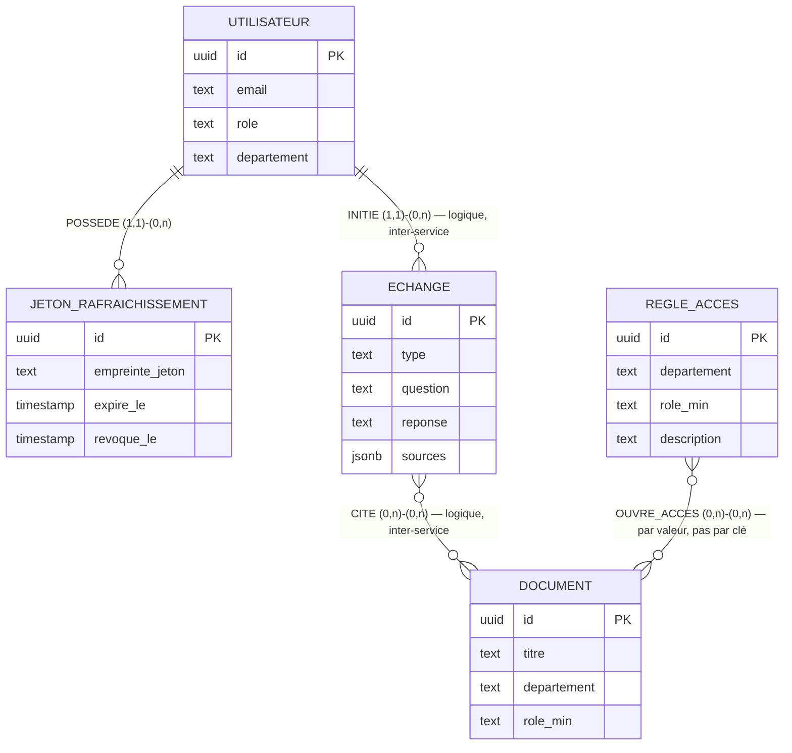
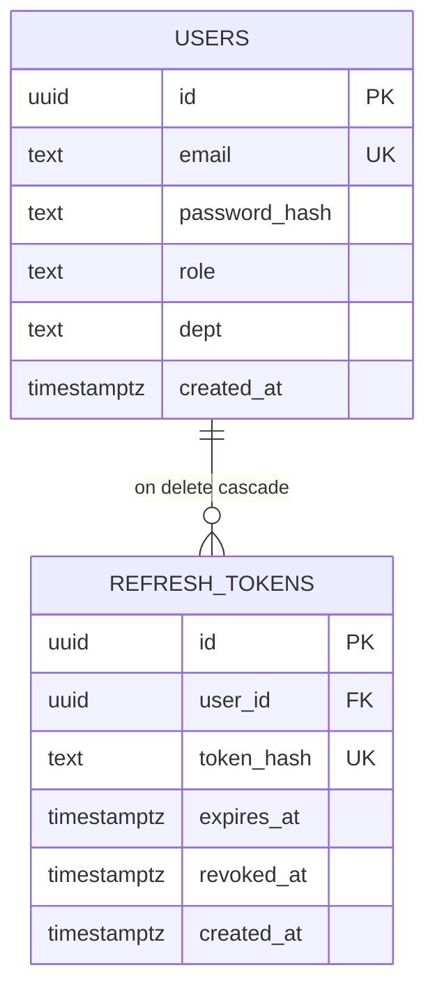
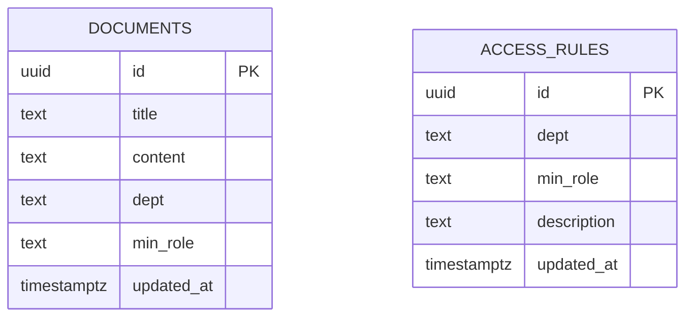
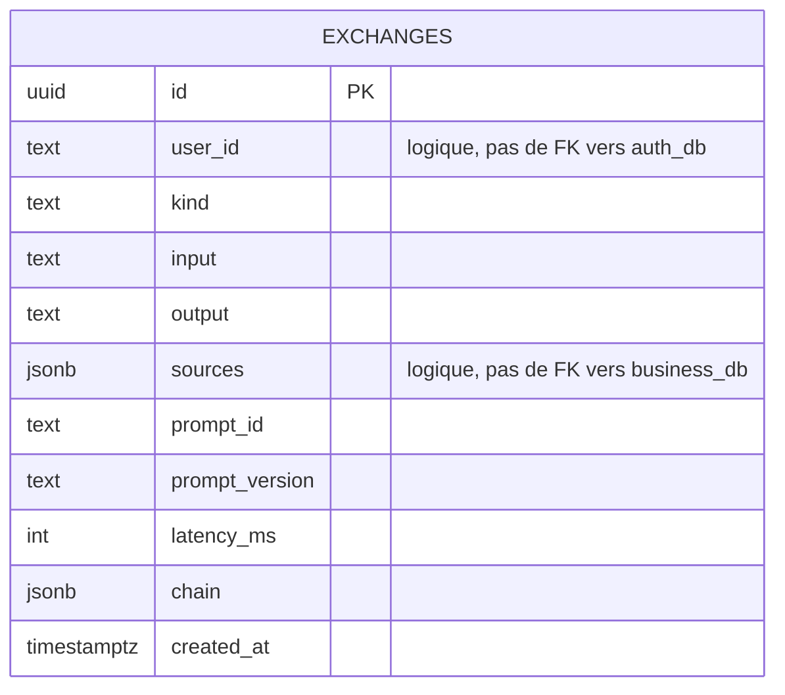

# Modèle de données (MCD / MLD)

Modèle conceptuel et modèle logique des données réellement implémentées (migrations SQL de chaque service, `apps/*/lib/db.ts`). Ce document n'est pas un livrable explicitement demandé par le sujet ING1 — il documente a posteriori le schéma construit en semaine 2, pour la soutenance (« Code Defense », isolation des données) et comme référence avant tout changement de schéma.

## 1. Rappel de contrainte : une base par service

Le MCD ci-dessous décrit le domaine métier dans son ensemble. Mais conformément à la règle de sécurité non négociable « aucun service ne se connecte à la base d'un autre » ([architecture.md](architecture.md#isolation-réseau)), il n'existe **aucune clé étrangère physique entre les trois bases** :

| Base | Service propriétaire | Réseau Docker |
| --- | --- | --- |
| `auth_db` | auth-service | `auth-db-net` |
| `business_db` | business-service | `business-db-net` |
| `agent_db` | ai-agent-service | `agent-db-net` |

Les associations qui traversent cette frontière (un utilisateur qui pose une question, un échange qui cite un document) sont **logiques** : elles transitent par API, avec le JWT de l'utilisateur ([interconnexion.md](interconnexion.md)), jamais par une jointure SQL. Le MCD les représente quand même (c'est le sens métier) ; le MLD, lui, respecte la séparation physique et l'indique explicitement.

## 2. MCD — Modèle conceptuel de données

### Entités et attributs

| Entité | Attributs | Identifiant |
| --- | --- | --- |
| **UTILISATEUR** | email, mot_de_passe_haché, rôle {employee, manager, admin}, département, créé_le | id |
| **JETON_RAFRAICHISSEMENT** | empreinte_jeton, expire_le, révoqué_le, créé_le | id |
| **DOCUMENT** | titre, contenu, département, rôle_min {employee, manager, admin}, maj_le | id |
| **REGLE_ACCES** | département, rôle_min {employee, manager, admin}, description, maj_le | id |
| **ECHANGE** | type {ask, summarize}, question, réponse, sources, id_prompt, version_prompt, modèle, jetons_prompt, jetons_completion, latence_ms, créé_le, chaîne_traitement | id |

`département` reste un attribut texte libre partout (pas d'entité DÉPARTEMENT normalisée) : c'est fidèle à l'implémentation, où le rapprochement se fait par égalité de valeur, pas par clé.

### Associations

| Association | Entités | Cardinalités | Sens |
| --- | --- | --- | --- |
| POSSEDE | UTILISATEUR ↔ JETON_RAFRAICHISSEMENT | (1,1) ↔ (0,n) | Un utilisateur possède 0 à n jetons de rafraîchissement ; un jeton appartient à exactement un utilisateur. |
| INITIE | UTILISATEUR ↔ ECHANGE | (1,1) ↔ (0,n) | Un utilisateur initie 0 à n échanges avec l'agent ; un échange est demandé par exactement un utilisateur. **Association logique inter-service** (voir §1) : `exchanges.user_id` est copié du JWT, sans clé étrangère vers `auth_db`. |
| CITE | ECHANGE ↔ DOCUMENT | (0,n) ↔ (0,n) | Un échange cite 0 à n documents comme sources ; un document peut être cité par 0 à n échanges. **Association logique** : les sources sont stockées en JSON (`sources: Source[]`) dans `agent_db`, pas en clé étrangère vers `business_db`. |
| OUVRE_ACCES | REGLE_ACCES ↔ DOCUMENT | (0,n) ↔ (0,n) | Une règle d'accès ouvre un département à un rôle minimal, ce qui élargit la visibilité de 0 à n documents de ce département ; un document peut être concerné par 0 à n règles. **Rapprochement par valeur** (`regle.departement = document.departement`), pas par clé — la règle est évaluée à chaque lecture, pas stockée comme un lien figé. |

### Diagramme



## 3. MLD — Modèle logique de données

Transcription des migrations réelles (`apps/*/lib/db.ts`), groupées par base physique. Notation : `TABLE(clé primaire, attribut, attribut FK → table.colonne)`.

### 3.1 `auth_db` (auth-service)

```
USERS(id, email, password_hash, role, dept, created_at)
REFRESH_TOKENS(id, user_id FK → USERS.id, token_hash, expires_at, revoked_at, created_at)
```

- `users.role` : `check (role in ('employee','manager','admin'))`. `users.email` : `unique`.
- `refresh_tokens.user_id` : `references users(id) on delete cascade` — seule vraie clé étrangère physique du projet, car les deux tables vivent dans la même base.
- `refresh_tokens.token_hash` : `unique` (empreinte SHA-256 du jeton, jamais le jeton en clair).
- Index `refresh_tokens_user_id` sur `user_id` (liste/révocation des sessions d'un utilisateur).



### 3.2 `business_db` (business-service)

```
DOCUMENTS(id, title, content, dept, min_role, updated_at)
ACCESS_RULES(id, dept, min_role, description, updated_at)
```

- `documents.min_role`, `access_rules.min_role` : `check (... in ('employee','manager','admin'))`.
- `access_rules` : `unique (dept, min_role)` — au plus une règle par couple département/rôle.
- Aucune clé étrangère entre les deux tables : la visibilité est calculée à chaque requête (`role_rank()`, voir [documents.ts](../apps/business-service/lib/documents.ts)), pas stockée.
- Index plein texte généré (`document_tsv`, fonction SQL) sur `title`/`content`, pondéré et sans accents.


*(pas de lien dessiné : `dept`/`min_role` sont comparés par valeur à l'exécution, aucune FK)*

### 3.3 `agent_db` (ai-agent-service)

```
EXCHANGES(id, user_id, kind, input, output, sources, prompt_id, prompt_version, model, prompt_tokens, completion_tokens, latency_ms, created_at, chain)
```

- `exchanges.user_id` : **texte, pas de type `uuid` ni de FK** — copié du JWT vérifié par `requireAuth`, jamais relu depuis `auth_db` (que ai-agent-service ne peut pas joindre).
- `exchanges.sources` (jsonb) : tableau de `{ ref, id, title }` — référence *par valeur* à des documents de `business_db`, pas une FK.
- `exchanges.chain` (jsonb, nullable) : trace de la chaîne de prompts (mots-clés de recherche, phrases retirées/corrigées par la vérification) — [interconnexion.md](interconnexion.md), analyse des hallucinations prévue en S4.
- `exchanges.kind` : `check (kind in ('ask','summarize'))`.
- Index `exchanges_user_created` sur `(user_id, created_at desc)` pour `GET /agent/history`.



## 4. Correspondance MCD → MLD

| Entité/association conceptuelle | Table physique | Remarque |
| --- | --- | --- |
| UTILISATEUR | `auth_db.users` | — |
| JETON_RAFRAICHISSEMENT | `auth_db.refresh_tokens` | POSSEDE devient une vraie FK (même base) |
| DOCUMENT | `business_db.documents` | — |
| REGLE_ACCES | `business_db.access_rules` | OUVRE_ACCES reste un calcul applicatif, jamais une FK |
| ECHANGE | `agent_db.exchanges` | INITIE et CITE restent des références logiques (texte / JSON), jamais une FK — frontière de service |

Cette dernière colonne est la partie à défendre à l'oral : une FK physique entre `exchanges.user_id` et `auth_db.users.id`, ou entre `exchanges.sources` et `business_db.documents.id`, violerait directement la règle « aucun service ne se connecte à la base d'un autre » (menace couverte : un service compromis ne peut pas lire — ni corrompre — les données d'un autre, voir [securite.md](securite.md)).
