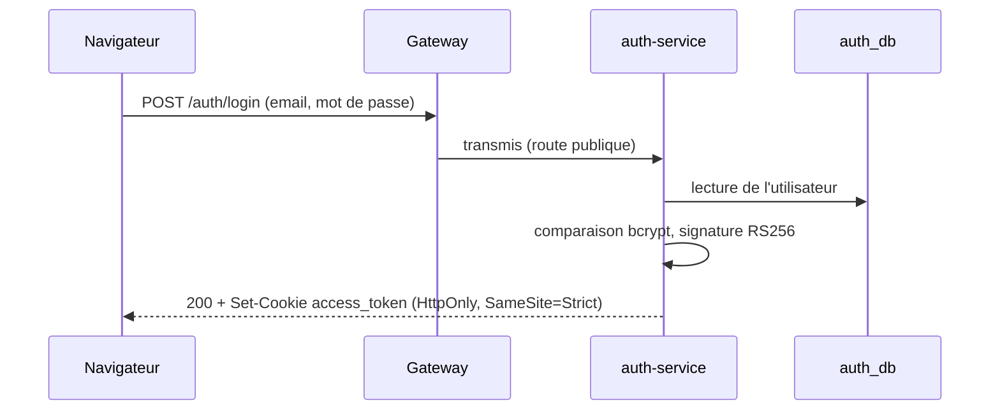
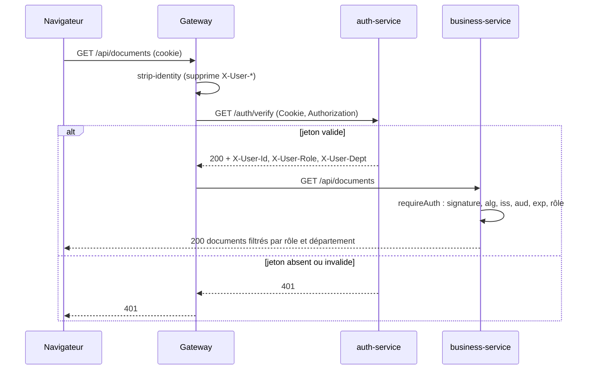
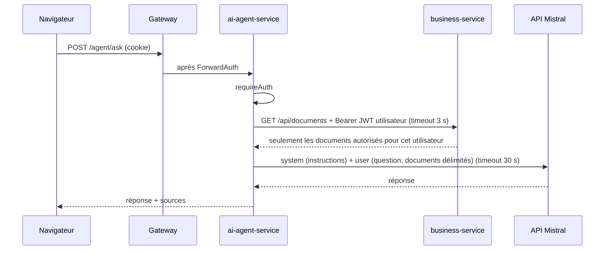

# Schéma de sécurité (JWT)

Objectif : seul auth-service peut émettre une identité, chaque service peut la vérifier seul, et aucune donnée n'est servie sans contrôle du rôle.

## Jeton d'accès

| Élément | Choix | Raison |
| --- | --- | --- |
| Algorithme | **RS256 uniquement** (liste blanche côté vérification) | Asymétrique : les services vérifient avec la clé publique sans pouvoir signer. Refuser tout autre `alg` bloque `alg: none` et la confusion RS256/HS256. |
| Clé privée | Uniquement dans auth-service, via variable d'environnement | Jamais dans le code ni dans Git (`keys/` et `.env` ignorés). |
| Clé publique | Publiée en JWKS sur `auth-service:3000/.well-known/jwks.json` (réseau interne) | Les services la récupèrent et la mettent en cache. L'en-tête `kid` permet la rotation. |
| Durée de vie | 15 minutes (`exp`) | Limite l'usage d'un jeton volé. Pas de liste de révocation à maintenir. |
| Transport navigateur | Cookie `access_token` : `HttpOnly`, `Secure` (en HTTPS), `SameSite=Strict`, `Path=/` | Illisible par JavaScript (XSS), non envoyé par un site tiers (CSRF). |
| Transport entre services | En-tête `Authorization: Bearer <JWT utilisateur>` | L'agent IA agit avec les droits de l'utilisateur, jamais avec des droits propres. |

Claims :

| Claim | Exemple | Vérifié |
| --- | --- | --- |
| `iss` | `microservices-hub-auth` | Égalité stricte |
| `aud` | `microservices-hub` | Égalité stricte |
| `sub` | identifiant de l'utilisateur | Présent |
| `role` | `employee`, `manager`, `admin` | Selon la route (`requireAuth(req, roles)`) |
| `dept` | département de l'utilisateur | Filtrage des données métier |
| `iat`, `exp` | horodatages | `exp` dans le futur (tolérance de 30 s) |
| `jti` | identifiant unique | Traçabilité |

Les mots de passe sont stockés hachés (bcrypt, coût 12) dans `auth_db`. Aucun autre service ne voit de mot de passe.

## Deux contrôles successifs

1. **Gateway (ForwardAuth)** : pour toute route protégée, Traefik appelle `GET /auth/verify` sur auth-service avant de transmettre la requête. Si le jeton est absent ou invalide, il répond 401 et la requête n'atteint jamais le service.
2. **Service (`requireAuth`)** : chaque route handler protégé appelle `requireAuth(req, roles?)` de `@hub/shared`. Cette fonction revérifie la signature, `alg`, `iss`, `aud` et `exp` avec le JWKS, puis contrôle le rôle.

Le second contrôle reste indispensable : un appel interne (agent → métier) ne passe pas par la gateway, et une erreur de configuration de la gateway ne doit pas suffire à ouvrir les données.

Le middleware Next.js n'est **jamais** utilisé comme contrôle d'accès : il peut être contourné (CVE-2025-29927).

### En-têtes d'identité

Après vérification, auth-service renvoie `X-User-Id`, `X-User-Role` et `X-User-Dept`, que Traefik transmet au service. Ces en-têtes servent aux journaux d'accès. Ils ne font pas foi : seul le JWT vérifié par `requireAuth` fait foi.

Le middleware `strip-identity` supprime tout en-tête `X-User-*` envoyé par le client **avant** ForwardAuth, pour qu'un client ne puisse pas se forger une identité.

### Routes et middlewares

| Route | Middlewares gateway (dans l'ordre) | Rôles |
| --- | --- | --- |
| `POST /auth/login` | strip-identity, security-headers | Public |
| `GET /auth/me`, `POST /auth/logout` | strip-identity, security-headers, jwt-auth | Connecté |
| `/auth/verify`, `/.well-known/jwks.json` | Non routées (internes uniquement) | — |
| `/api/**` | strip-identity, security-headers, jwt-auth | Selon la route (règles : `admin`) |
| `/agent/**` | strip-identity, security-headers, jwt-auth | Connecté |
| `/` (front) | strip-identity, security-headers | Public |

CORS (liste blanche d'origines) et rate limiting s'ajoutent en semaine 2.

## Mise en œuvre

| Élément | Semaine | Où |
| --- | --- | --- |
| Middlewares `strip-identity` et `jwt-auth`, routes internes non exposées | S1 (configuré) | `infra/traefik/dynamic.yml` |
| Isolation réseau (aucun port publié hors gateway, une base par service) | S1 (configuré) | `docker-compose.yml` |
| auth-service : login, signature RS256, JWKS, `/auth/verify` | S2 | `apps/auth-service` |
| `requireAuth(req, roles?)` et format d'erreur commun | S2 | `packages/shared` |
| CORS, rate limiting, refresh token | S2 | `infra/traefik/dynamic.yml`, `apps/auth-service` |

Tant que `/auth/verify` n'existe pas (semaine 2), ForwardAuth reçoit une erreur d'auth-service et **refuse toutes les routes protégées** : la gateway est fermée par défaut.

## Flux

### Connexion

### Requête métier

### Question à l'agent IA

L'agent ne détient aucun droit propre sur les données : ce que le LLM reçoit est exactement ce que l'utilisateur a le droit de lire. Les documents sont placés dans une balise `<documents>` et les instructions restent dans le message system, pour limiter l'injection de prompt. La clé Mistral n'existe que dans ai-agent-service, seul service ayant un accès Internet.

## Menaces traitées

| Menace | Parade |
| --- | --- |
| Jeton forgé ou `alg: none` | Signature RS256 obligatoire, `alg` en liste blanche |
| Confusion RS256 / HS256 | Vérification avec la clé publique uniquement, `alg` imposé |
| Jeton d'un autre émetteur ou destiné à une autre application | Contrôle de `iss` et `aud` |
| Vol de jeton par XSS | Cookie `HttpOnly`, durée de vie de 15 minutes |
| CSRF | `SameSite=Strict`, front sur la même origine, CORS en liste blanche (jamais `*`, semaine 2) |
| Usurpation d'identité par en-têtes `X-User-*` | `strip-identity` avant ForwardAuth, services qui revérifient le JWT |
| Contournement du middleware Next.js (CVE-2025-29927) | Contrôle dans chaque route handler via `requireAuth` |
| Accès direct à un service ou à une base | Aucun port publié hors gateway, réseaux Docker `internal` |
| Escalade via l'agent IA | Données récupérées avec le JWT de l'utilisateur, jamais en direct depuis une base |
| Injection de prompt | Instructions en system, données délimitées, sortie non exécutée |
| Force brute sur le login | Rate limiting à 5 requêtes par minute (semaine 2) |
| Fuite de secrets | Variables d'environnement, `.env` et `keys/` ignorés par Git |

## Limites connues et évolutions

- **Déconnexion** : `POST /auth/logout` supprime le cookie, mais un jeton déjà copié reste valide jusqu'à son `exp` (15 minutes au plus). C'est le compromis d'un jeton sans état.
- **Refresh token (semaine 2)** : jeton opaque, stocké haché dans `auth_db`, renouvelé à chaque usage, cookie limité à `Path=/auth/refresh`. La déconnexion le révoque.
- **Rotation des clés** : nouvelle paire avec un nouveau `kid`. L'ancienne clé publique reste dans le JWKS pendant 15 minutes, puis est retirée.
- **HTTPS** : terminé par le reverse proxy en production. En local, HTTP seul, donc cookie sans `Secure`.
