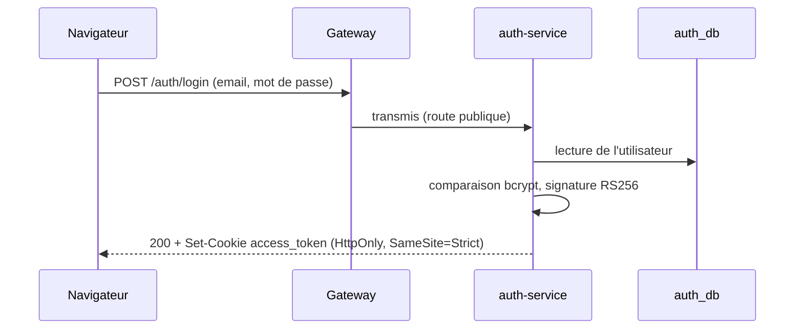
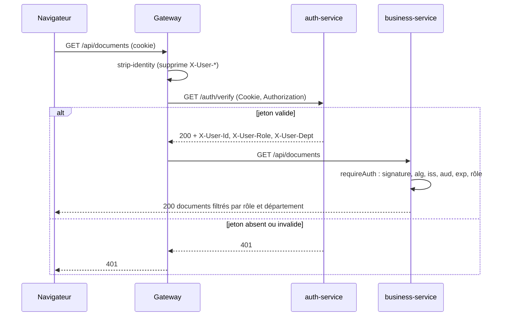
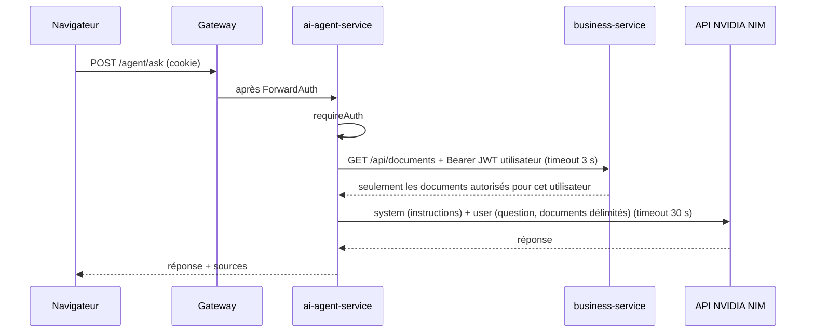

# Schéma de sécurité (JWT)

Objectif : seul auth-service peut émettre une identité, chaque service peut la vérifier seul, et aucune donnée n'est servie sans contrôle du rôle.

## Jeton d'accès

| Élément | Choix | Raison |
| --- | --- | --- |
| Algorithme | **RS256 uniquement** (liste blanche côté vérification) | Asymétrique : les services vérifient avec la clé publique sans pouvoir signer. Refuser tout autre `alg` bloque `alg: none` et la confusion RS256/HS256. |
| Clé privée | Uniquement dans auth-service, variable `JWT_PRIVATE_KEY` (générée par `pnpm env:init`) | Jamais dans le code ni dans Git (`keys/` et `.env` ignorés). Sans clé valide, auth-service refuse de démarrer. |
| Clé publique | Publiée en JWKS sur `auth-service:3000/.well-known/jwks.json` (réseau interne) | Les services la récupèrent et la mettent en cache. L'en-tête `kid` permet la rotation. |
| Durée de vie | 15 minutes (`exp`) | Limite l'usage d'un jeton volé. Pas de liste de révocation à maintenir. |
| Transport navigateur | Cookie `access_token` : `HttpOnly`, `Secure` (en HTTPS), `SameSite=Strict`, `Path=/` | Illisible par JavaScript (XSS), non envoyé par un site tiers (CSRF). |
| Transport entre services | En-tête `Authorization: Bearer <JWT utilisateur>` | L'agent IA agit avec les droits de l'utilisateur, jamais avec des droits propres. |

Claims :

| Claim | Exemple | Vérifié |
| --- | --- | --- |
| `iss` | `microservices-hub-auth` | Égalité stricte |
| `aud` | `microservices-hub` | Égalité stricte |
| `sub` | identifiant de l'utilisateur | Présent |
| `role` | `employee`, `manager`, `admin` | Selon la route (`requireAuth(req, roles)`) |
| `dept` | département de l'utilisateur | Filtrage des données métier |
| `iat`, `exp` | horodatages | `exp` dans le futur (tolérance de 30 s) |
| `jti` | identifiant unique | Présent (traçabilité) |

Le jeton ne contient ni email ni nom : il est transmis à chaque service, il n'emporte que ce qui sert au contrôle d'accès.

Les mots de passe sont stockés hachés (bcrypt, coût 12) dans `auth_db`. Aucun autre service ne voit de mot de passe. Pour un email inconnu, auth-service compare quand même le mot de passe à une empreinte factice : la réponse prend le même temps et porte le même message (« Identifiants invalides »), ce qui empêche de deviner quels comptes existent.

## Refresh token

| Élément | Choix | Raison |
| --- | --- | --- |
| Forme | 32 octets aléatoires (base64url), opaque | Rien à décoder ni à forger |
| Stockage | Empreinte SHA-256 dans `auth_db.refresh_tokens` | Une fuite de la base ne donne pas de jeton utilisable |
| Durée de vie | 7 jours | Reconnexion hebdomadaire au plus |
| Usage | Unique : chaque `POST /auth/refresh` révoque le jeton présenté et en émet un nouveau | Un jeton volé ne sert qu'une fois |
| Rejeu | Un jeton déjà utilisé qui revient révoque **toutes** les sessions de l'utilisateur | Le vol est détecté dès que le voleur ou la victime s'en sert en second |
| Cookie | `refresh_token` : `HttpOnly`, `SameSite=Strict`, `Path=/auth` | Jamais envoyé à `/api` ni à `/agent` : business-service et l'agent IA ne le voient jamais |
| Déconnexion | `POST /auth/logout` révoque le refresh token et vide les deux cookies | Fonctionne même avec un jeton d'accès expiré (route sans `jwt-auth`) |

## Deux contrôles successifs

1. **Gateway (ForwardAuth)** : pour toute route protégée, Traefik appelle `GET /auth/verify` sur auth-service avant de transmettre la requête. Si le jeton est absent ou invalide, il répond 401 et la requête n'atteint jamais le service.
2. **Service (`requireAuth`)** : chaque route handler protégé appelle `requireAuth(req, roles?)` de `@hub/shared` (`packages/shared/src/auth.ts`). Cette fonction revérifie la signature, `alg`, `iss`, `aud`, `exp` et la forme des claims avec le JWKS, puis contrôle le rôle (403 si insuffisant). Si le JWKS est injoignable et qu'aucune clé n'est en cache : 502.

Le second contrôle reste indispensable : un appel interne (agent → métier) ne passe pas par la gateway, et une erreur de configuration de la gateway ne doit pas suffire à ouvrir les données.

Le middleware Next.js n'est **jamais** utilisé comme contrôle d'accès : il peut être contourné (CVE-2025-29927).

### En-têtes d'identité

Après vérification, auth-service renvoie `X-User-Id`, `X-User-Role` et `X-User-Dept`, que Traefik transmet au service. Ces en-têtes servent aux journaux d'accès. Ils ne font pas foi : seul le JWT vérifié par `requireAuth` fait foi.

Le middleware `strip-identity` supprime tout en-tête `X-User-*` envoyé par le client **avant** ForwardAuth, pour qu'un client ne puisse pas se forger une identité.

### Routes et middlewares

| Route | Middlewares gateway (dans l'ordre) | Rôles |
| --- | --- | --- |
| `POST /auth/login` | strip-identity, security-headers, cors, rate-limit-json, rate-login | Public (5 req/min par IP) |
| `POST /auth/refresh`, `POST /auth/logout` | strip-identity, security-headers, cors | Refresh token |
| `GET /auth/me` | strip-identity, security-headers, cors, jwt-auth | Connecté |
| `/auth/verify`, `/.well-known/jwks.json` | Non routées (internes uniquement) | — |
| `/api/**` | strip-identity, security-headers, cors, jwt-auth | Selon la route (règles : `admin`) |
| `/agent/**` | strip-identity, security-headers, cors, rate-limit-json, jwt-auth, rate-agent | Connecté (10 req/min par utilisateur) |
| `/` (front) | strip-identity, security-headers | Public |

Détail de CORS et du rate limiting : [gateway.md](gateway.md).

## Mise en œuvre

| Élément | Semaine | Où |
| --- | --- | --- |
| Middlewares `strip-identity` et `jwt-auth`, routes internes non exposées | S1 | `infra/traefik/dynamic.yml` |
| Isolation réseau (aucun port publié hors gateway, une base par service) | S1 | `docker-compose.yml` |
| auth-service : login, signature RS256, JWKS, `/auth/verify`, refresh token, logout | S2 | `apps/auth-service` |
| `requireAuth(req, roles?)` et format d'erreur commun | S2 | `packages/shared/src/auth.ts`, `route.ts` |
| Filtrage des documents par rôle et département, dans la requête SQL | S2 | `apps/business-service/lib/documents.ts` |
| CORS (liste blanche), rate limiting (login, agent) | S2 | `infra/traefik/dynamic.yml` |
| Garde-fous des prompts | S2 | `apps/ai-agent-service/lib/prompts.ts`, [prompt-book.md](prompt-book.md) |

Vérifié par les tests unitaires (`pnpm test`, dont `alg: none`, HS256, `iss`/`aud`, expiration) et de bout en bout (`pnpm test:e2e` : jeton forgé, en-têtes `X-User-*` forgés, filtrage, CORS, rate limiting, rejeu de refresh token).

## Flux

### Connexion

### Requête métier

### Question à l'agent IA

L'agent ne détient aucun droit propre sur les données : ce que le LLM reçoit est exactement ce que l'utilisateur a le droit de lire. Les documents sont placés dans une balise `<documents>`, échappés, et les instructions restent dans le message system, pour limiter l'injection de prompt. La clé NIM n'existe que dans ai-agent-service, seul service ayant un accès Internet. Détail des prompts et de leurs garde-fous : [prompt-book.md](prompt-book.md).

## Menaces traitées

| Menace | Parade |
| --- | --- |
| Jeton forgé ou `alg: none` | Signature RS256 obligatoire, `alg` en liste blanche |
| Confusion RS256 / HS256 | Vérification avec la clé publique uniquement, `alg` imposé |
| Jeton d'un autre émetteur ou destiné à une autre application | Contrôle de `iss` et `aud` |
| Vol de jeton par XSS | Cookie `HttpOnly`, durée de vie de 15 minutes |
| CSRF | `SameSite=Strict`, front sur la même origine, CORS en liste blanche (jamais `*`) |
| Usurpation d'identité par en-têtes `X-User-*` | `strip-identity` avant ForwardAuth, services qui revérifient le JWT |
| Contournement du middleware Next.js (CVE-2025-29927) | Contrôle dans chaque route handler via `requireAuth` |
| Accès direct à un service ou à une base | Aucun port publié hors gateway, réseaux Docker `internal` |
| Escalade via l'agent IA | Données récupérées avec le JWT de l'utilisateur, jamais en direct depuis une base |
| Injection de prompt | Instructions en system, données délimitées et échappées, sources vérifiées, sortie affichée comme du texte |
| Énumération des comptes | Même message et même temps de réponse que l'email existe ou non |
| Force brute sur le login | Rate limiting à 5 requêtes par minute et par IP |
| Abus de l'agent IA (coût du LLM) | Rate limiting à 10 requêtes par minute et par utilisateur |
| Vol de refresh token | Usage unique, empreinte seule en base, rejeu = révocation de toutes les sessions |
| Fuite de secrets | Variables d'environnement, `.env` et `keys/` ignorés par Git |

## Limites connues et évolutions

- **Déconnexion** : `POST /auth/logout` supprime le cookie, mais un jeton déjà copié reste valide jusqu'à son `exp` (15 minutes au plus). C'est le compromis d'un jeton sans état.
- **Rotation des clés** : générer une nouvelle paire (nouveau `kid`), mettre l'ancienne clé publique dans `JWT_PREVIOUS_PUBLIC_KEY` : elle reste publiée dans le JWKS et les jetons déjà émis restent valides. Après 15 minutes (durée de vie d'un jeton), vider `JWT_PREVIOUS_PUBLIC_KEY`.
- **Renouvellements simultanés** : deux `POST /auth/refresh` envoyés en même temps avec le même jeton sont pris pour un rejeu, et toutes les sessions sont révoquées. Le front partage donc un seul renouvellement entre ses appels ; deux onglets qui renouvellent à la même seconde peuvent encore déconnecter l'utilisateur (il se reconnecte).
- **Rate limiting en mémoire** : les compteurs de la gateway repartent de zéro à son redémarrage (voir [gateway.md](gateway.md)).
- **HTTPS** : terminé par le reverse proxy en production. En local, HTTP seul, donc cookie sans `Secure`.
